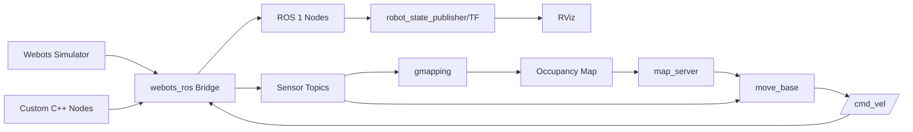

<div align="center">

# Mapping Robot

Mapping and autonomous navigation robot in Webots (ROS 1) for exploration, SLAM, path planning and obstacle avoidance.

</div>

---

## Table of Contents

- [Overview](#overview)
- [Features](#features)
- [Tech Stack](#tech-stack)
- [Architecture](#architecture)
- [Project Structure](#project-structure)
- [Getting Started](#getting-started)
- [Configuration](#configuration)
- [Usage](#usage)
- [Testing](#testing)
- [Roadmap](#roadmap)

---

## Overview

**Problem:** Simulate and test a differential-drive mapping/navigation robot without requiring physical hardware.

**Solution:** ROS 1 packages integrated with Webots simulator provide SLAM (gmapping), localization, global/local path planning (move_base), costmaps, and visualization (RViz) for mapping and autonomous navigation.

**Status:** `Active`

---

## Features

- **Webots simulation** — runs robot/world models with sensor interfaces via `webots_ros`.
- **Robot description** — URDF/Xacro models for visualization and transforms (TF).
- **SLAM/Mapping** — `gmapping` for building occupancy grid maps from laser/LIDAR data.
- **Localization** — `amcl` and custom localization node support (depending on launch).
- **Navigation/Planning** — `move_base` with global planner (Navfn/Dijkstra) and local planner (TrajectoryPlanner/DWA variants) plus recovery behaviors.
- **Costmap configuration** — global/local/common costmaps with obstacle inflation.
- **Remapping/bridge nodes** — custom C++ nodes (`remap`, `enable`, `dynamic_link_camera`, `localize`) to interface sensors/teleop between Webots and ROS.
- **Prebuilt maps** — occupancy grid maps (`.pgm`/`.yaml`) included.
- **Visualization** — RViz configuration files for robot and navigation views.

---

## Tech Stack

| Layer      | Technology                     |
|------------|--------------------------------|
| Language   | C++ (catkin), XML (launch/URDF/Xacro), YAML |
| Middleware | ROS 1 (Noetic/compatible Catkin) |
| Simulator  | Webots (via `webots_ros`)      |
| Navigation | move_base, amcl, gmapping, map_server, costmap_2d, navfn |
| Transform  | TF (tf)                        |
| Visualization | RViz                       |

---

## Architecture

**High-level flow:** Webots simulates robot sensors/actuators. `webots_ros` bridges topics/services. Robot state is published via `robot_state_publisher` (URDF) with TF. SLAM (`gmapping`) builds occupancy maps; `map_server` loads maps. `move_base` uses global/local costmaps and planners for navigation and obstacle avoidance. RViz visualizes state, map, paths, and costmaps.



### Components

| Component | Responsibility | Location |
|-----------|----------------|----------|
| `bringup` | Main launch, Webots integration, robot bring-up, RViz, maps, URDF/Xacro, custom nodes (`localize`, `enable`, `dynamic_link_camera`) | `bringup/` |
| `robot_settings` | Robot configuration, URDF/Xacro variants, RViz configs, maps, launch files, custom nodes (`enable`, `localize`, etc.) | `robot_settings/` |
| `nav_plan_objavoid` | Navigation planning and obstacle avoidance via `move_base`; costmap/planner configs; remapping node (`remap`) | `nav_plan_objavoid/` |

### Key Design Decisions

- **Webots + webots_ros**: Simulation-first approach for repeatable mapping/navigation experiments.
- **Modular ROS packages**: Separation of bring-up, robot settings, and navigation planning.
- **Catkin + C++ nodes**: Lightweight sensor/teleop bridging and custom logic.
- **move_base stack**: Standard ROS navigation for global/local planning and costmaps.

---

## Project Structure

```text
Mapping Robot/
├── bringup/
│   ├── CMakeLists.txt
│   ├── package.xml
│   ├── include/              # Headers (localization.h, sensor_enable.h, static_camera.h)
│   ├── launch/               # master.launch, description.launch
│   ├── maps/                 # home.pgm, home.yaml
│   ├── protos/               # Webots proto (Cam_robot.proto)
│   ├── robot_description/    # URDF/Xacro + launch
│   ├── src/                  # C++ nodes (localization.cpp, sensor_enable.cpp, static_camera.cpp)
│   ├── visualization/        # RViz configs/launch
│   └── worlds/               # Webots worlds (.wbt)
├── nav_plan_objavoid/
│   ├── CMakeLists.txt
│   ├── package.xml
│   ├── config/                # Costmaps, local/global planners (YAML)
│   ├── include/               # remapping.h
│   ├── launch/                # navigation_planning.launch
│   ├── rviz/                   # nav.rviz
│   └── src/                    # remapping.cpp
├── robot_settings/
│   ├── CMakeLists.txt
│   ├── package.xml
│   ├── include/               # localization.h, sensor_enable.h, static_camera.h
│   ├── launch/                 # master.launch
│   ├── maps/                   # home.pgm, home.yaml
│   ├── protos/                 # Cam_robot.proto
│   ├── robot_description/      # URDF/Xacro + launch (CleaningRobot)
│   ├── rviz/                    # RViz configs/launch
│   ├── src/                     # C++ nodes
│   └── worlds/                  # Webots worlds (Home.wbt, CleaningRobot.wbt)
└── README.md
```

---

## Getting Started

### Prerequisites

- Ubuntu (tested on ROS 1 environment, e.g. Ubuntu 20.04 with Noetic) or similar Linux with ROS 1 installed.
- [ROS 1](http://wiki.ros.org/ROS/Installation) (Noetic recommended).
- [Webots](https://cyberbotics.com/).
- [webots_ros](http://wiki.ros.org/webots_ros) package available in your ROS workspace.
- Build tools: `catkin_tools` or `catkin_make`, `gcc/g++`.

### Installation

```bash
# 1. Create/prepare a catkin workspace
mkdir -p ~/catkin_ws/src
cd ~/catkin_ws/src

# 2. Clone/copy this project into src
# Copy Mapping Robot contents (bringup, nav_plan_objavoid, robot_settings)
cp -r /path/to/Mapping\ Robot/bringup .
cp -r /path/to/Mapping\ Robot/nav_plan_objavoid .
cp -r /path/to/Mapping\ Robot/robot_settings .

# 3. Install ROS dependencies (if rosdep available)
cd ~/catkin_ws
rosdep update
rosdep install --from-paths src --ignore-src -r -y

# 4. Build
catkin_make  # or catkin build

# 5. Source workspace
source ~/catkin_ws/devel/setup.bash
```

The packages are standard Catkin packages (CMakeLists.txt + package.xml). No external Python/Node package managers detected.

---

## Configuration

### Environment Variables

| Variable        | Required | Default | Description             |
|-----------------|----------|---------|-------------------------|
| `ROS_MASTER_URI` | No       | `http://localhost:11311` | ROS master URI |
| `ROS_HOSTNAME`   | No       | —       | Hostname for ROS nodes |

> No `.env.example` present. Use standard ROS environment variables. Never commit real secrets.

### Key Config Files

| Config | Purpose |
|-------|---------|
| `bringup/launch/master.launch` | Bring-up with Webots (home.wbt), URDF, RViz, sensor/teleop/localization nodes |
| `robot_settings/launch/master.launch` | Full setup including map server, remap, teleop, move_base launch, RViz |
| `nav_plan_objavoid/config/Common_Costmap.yaml` | Common global/local costmap params |
| `nav_plan_objavoid/config/global/Global_Costmap.yaml` | Global costmap |
| `nav_plan_objavoid/config/global/Dijkstra_NavfnROS_Planner_Global.yaml` | Global planner (Navfn/Dijkstra) |
| `nav_plan_objavoid/config/local/Local_Costmap.yaml` | Local costmap |
| `nav_plan_objavoid/config/local/TrajectoryPlanner_Local.yaml` | Local planner (base_local_planner) |
| `*/maps/home.yaml` | Map metadata (resolution/origin/thresh) for home.pgm |

---

## Usage

### Option 1: Basic bring-up (bringup package)

```bash
source ~/catkin_ws/devel/setup.bash
roslaunch bringup master.launch
```

Launches: Webots (`home.wbt`), URDF description, TF, RViz (`4wheelrobot_viz.launch`), teleop (`enable`), dynamic camera link, localization (`localize`). Map server commented out in this launch.

### Option 2: Full mapping/navigation (robot_settings + nav_plan_objavoid)

```bash
source ~/catkin_ws/devel/setup.bash
roslaunch robot_settings master.launch
```

Launches: Webots (`Home.wbt`), URDF (`CleaningRobot.launch`), RViz (`CleaningRobot_viz.launch`), navigation_planning (`move_base`), `map_server` with `robot_settings/maps/home.yaml`, `remap` node, `teleop` node, localization node (`localize`), static camera/dynamic link nodes as included.

### Common Teleop/Navigation

- Use keyboard teleop via the `teleop`/`enable` node launched (depends on implementation in `sensor_enable.cpp`).
- Set navigation goals in RViz (2D Nav Goal) when `move_base` is running.
- Monitor costmaps/paths in RViz using provided `.rviz` configs.

### Verify Nodes/Topics (example)

```bash
rostopic list
rosnode list
rosservice list
```

---

## Testing

No test files (`tests/`, `test/`, `*_test.cpp`, `*_test.py`) or CI workflows detected in the repository. Standard ROS testing (rostest/catkin tests) not present.

```bash
# Build check
cd ~/catkin_ws && catkin_make
```

- TODO: Add unit/integration tests if/when implemented.

---

## Roadmap

- [x] Webots simulation setup with bring-up
- [x] URDF/Xacro robot models and TF
- [x] Costmap/planner configs for move_base
- [x] Prebuilt occupancy maps
- [ ] TODO: Add launch validation/tests
- [ ] TODO: Document node interfaces (topics/services) explicitly
- [ ] TODO: Add usage examples for mapping vs. navigation modes

---
